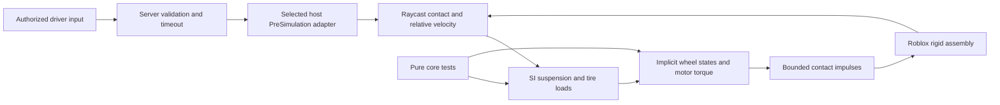

# Architecture

The initial implementation is a single rigid assembly with four raycast contacts. It provides an observable reference for testing script-owned tire forces. This is a provisional architecture decision, not a finding that raycasts are universally the most realistic contact model.

## Boundaries

`src/core` contains scalar functions and structural types without `game`, services, Instances, or engine scheduling. `src/roblox/Vehicle.luau` owns the engine adapter; `VehicleFactory` creates the same fixture for the sandbox and tests. `ClientDriver` and `DriverSession` implement the host/transport boundary. `src/config/Runtime.luau` selects the execution host, and `src/presets` contains synthetic parameters.

The adapter runs in `PreSimulation` on the selected host, using the supplied simulation interval. It does not pretend that repeated Luau calculations advance Roblox's world solver. A frame longer than 0.1 s skips impulse injection and invalidates a fidelity run; elapsed time and skipped-step counts remain observable. This is a development guard, not a hitch-recovery integrator.

## Contact and tires

The spring/damper supports each query contact with a nonnegative capped load. Ground velocity is subtracted at the contact point, including angular motion for BaseParts. Dynamic ground receives the opposite impulse. Terrain is treated as static.

All contact loads and tire forces are evaluated before any contact impulse is applied. This avoids sampling later wheels from velocities already changed by earlier wheels in the same update.

`Tire.brush` implements an original radial extension of a cubic brush saturation law. It provides an inspectable combined-force envelope. The sandbox uses its lateral branch and allocates the remaining friction-circle budget to a monotone saturated **linear longitudinal** law. The latter is solved implicitly with wheel rotation and dry brake torque. This split is deliberate for a small stable reference and is not a complete combined-slip brush or Magic Formula implementation.

At every wheel update, with contact velocity and load frozen:

`I * (omegaNext - omega) / dt = driveTorque - radius * Fx(omegaNext) - brakeTorque * sign(omegaNext)`

The zero-speed brake interval is tested first. A strictly increasing scalar residual is then solved by bounded bisection. Tests check its analytic unsaturated limit and discrete torque balance in forward, reverse, traction, braking, saturated, and airborne regimes. Stability of this isolated solve does **not** establish stability of the coupled chassis/contact system.

The adapter caps lateral impulse against a quarter-assembly-mass estimate to avoid an immediate low-speed sign reversal in that local approximation. It does not solve the full rotational effective mass. The 4 m/s slip denominator is a conservative synthetic numerical setting. Precision slope hold, parking friction, and body/wheel coupled stability remain measured research tasks.

## Powertrain and suspension fidelity

The reference EV uses independent rear wheel envelopes, reduction gearing, and a fixed efficiency. This is a simplified twin-motor abstraction, not a shared motor with an open or limited-slip differential. It has no battery, thermal dynamics, regeneration, rolling resistance, or motor reaction torque. The ray suspension has no unsprung mass, wheel-hop mode, kinematic camber, or anti-roll bar. Tire normal load is a model estimate, not an engine contact-force measurement.

## Networking

The sandbox accepts an exact input schema only from the occupied seat's player. It rejects nonfinite/out-of-range values and limits accepted input to 40 packets/s. The client sends at approximately 30 Hz. The default Server host keeps conventional server ownership. The experimental Client host transfers ownership to the current driver and runs the same adapter on that client. Ownership epochs select one controller, while idle/stale-input behavior reclaims server ownership and brakes after 0.5 s without valid input.

Neither host implements Roblox Server Authority prediction/rollback. Mutable wheel state lives in ordinary tables, so the adapter is not rollback safe. Ownership handoff initializes wheel speed from chassis motion; it does not preserve tire transient history. Input validation does not make client-owned physics trustworthy against a modified client. Moving-ground ownership conflicts, imposed network latency, reconciliation, and competitive anti-cheat remain unvalidated. See ADR-003 and ADR-004.

## Known sandbox limits

- Single-ray contacts can miss curbs, sidewalls, narrow obstacles, and initial-overlap cases.
- Chassis collisions still use native contact; visual wheels do not collide, steer, or roll visually.
- Character seating changes total assembly mass and mass distribution.
- The initial slope-hold characterization measured 0.1178 m creep over 8 s on a 10% grade, failing its 0.01 m target. Static friction/contact remains an open modeling task.
- Drag calibration, high-speed/curb robustness, imposed-latency networking, and mobile performance remain unvalidated.
- Keyboard-only example input has no mobile/gamepad support or production camera/HUD.
- No claim of deterministic replay, certified braking, or competition-grade anti-cheat is made.
